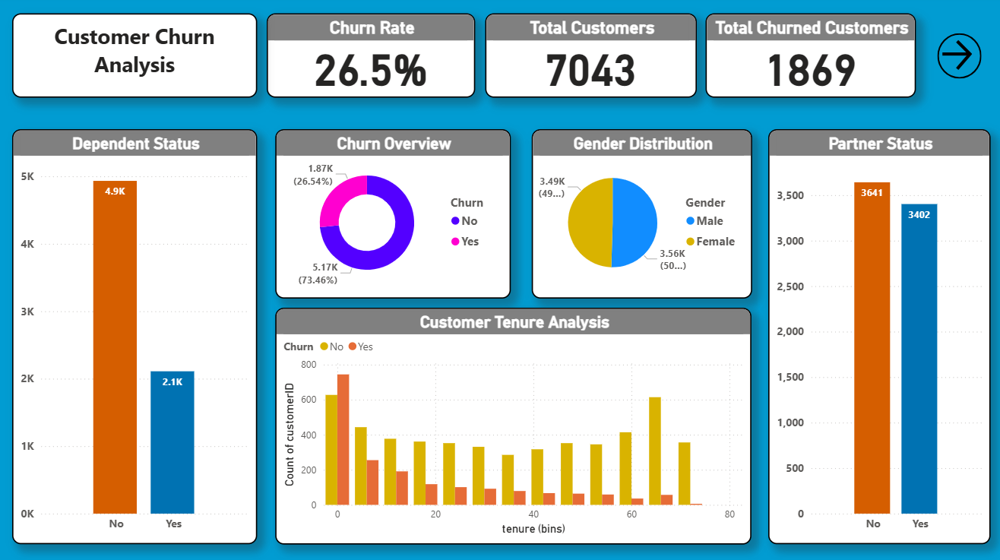
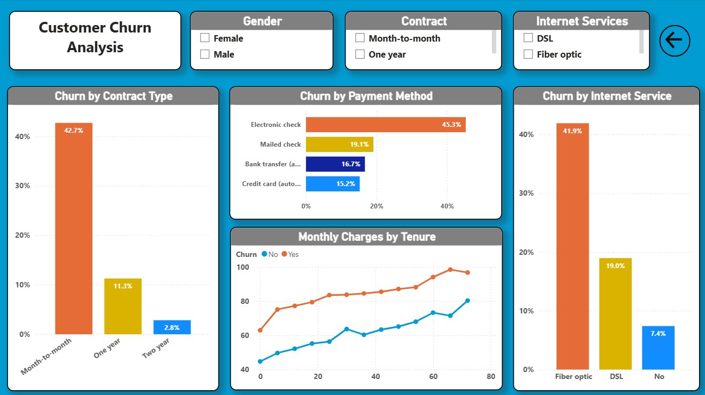

# Customer Churn Analysis

Power BI dashboard on telecom customer churn: who leaves, and which customer segments carry the highest churn rates.

This is a descriptive analysis. It measures and visualizes churn; it does not build a predictive model.

## Data

The widely used public *Telco Customer Churn* dataset, included here as [`Telco_Customer_Churn_Dataset  (2).csv`](<Telco_Customer_Churn_Dataset  (2).csv>): 7,043 customers, 21 columns (demographics, services, contract, billing, tenure, churn flag).

Data checks:

- 0 duplicate `customerID` values, 0 null cells.
- 11 customers have a blank `TotalCharges`. All 11 have tenure 0 (brand-new customers), and none churned.

## Key findings

Overall churn is **26.54%** (1,869 of 7,043 customers). Rates below are churned customers divided by customers in the segment.

| Segment | Customers | Churn rate |
|---|---|---|
| Month-to-month contract | 3,875 | **42.71%** |
| One-year contract | 1,473 | 11.27% |
| Two-year contract | 1,695 | 2.83% |
| Electronic check | 2,365 | **45.29%** |
| Mailed check | 1,612 | 19.11% |
| Bank transfer (automatic) | 1,544 | 16.71% |
| Credit card (automatic) | 1,522 | 15.24% |
| Fiber optic internet | 3,096 | **41.89%** |
| DSL internet | 2,421 | 18.96% |
| No internet service | 1,526 | 7.40% |
| Tenure 0-12 months | 2,186 | **47.44%** |
| Tenure 13-24 months | 1,024 | 28.71% |
| Tenure 25-48 months | 1,594 | 20.39% |
| Tenure 49-72 months | 2,239 | 9.51% |

What stands out:

- **Contract type** separates churn most sharply: month-to-month customers churn at about 15 times the two-year rate.
- **Month-to-month and electronic check together:** 994 of 1,850 customers (53.73%) churned.
- **Fiber optic customers pay more and churn more.** Average monthly charge is 91.50 for fiber against 58.10 for DSL. Churned customers paid 74.44 on average against 61.27 for retained customers.
- **Newer customers churn most.** Nearly half of customers in their first 12 months churned.
- **Gender shows no meaningful difference:** 26.92% for female and 26.16% for male customers.
- Customers without a partner (32.96% vs 19.66%), without dependents (31.28% vs 15.45%), and senior citizens (41.68% vs 23.61%) churn at higher rates.

These are associations in one dataset, not proof of cause.

## Where I would look first

- Offer incentives to move month-to-month customers onto one-year or two-year contracts.
- Check why electronic-check customers churn at roughly three times the rate of automatic-payment customers (billing friction, a customer mix effect, or both).
- Review the fiber optic offer, since it combines the highest prices with high churn.
- Add onboarding or early-life check-ins for the first 12 months.

## Dashboard

[`Customer Churn Analysis and Prediction.pbix`](<Customer Churn Analysis and Prediction.pbix>) has two pages:

- **Overview:** churn rate, total and churned customers, churn split, gender, dependents, partner status, tenure distribution.
- **Drill-down:** churn rate by contract type, payment method and internet service, monthly charges by tenure, with gender, contract and internet service slicers.

## Tools

Power BI, Excel.

## Author

Prashant Kashyap | [LinkedIn](https://linkedin.com/in/prashantrix) | [GitHub](https://github.com/prashantrix)
